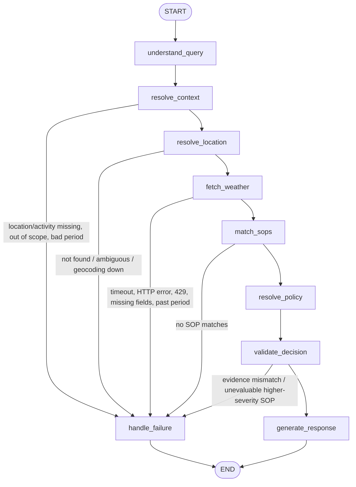

# Weather-Advisory Support Bot

A conversational assistant that answers outdoor-activity safety questions ("Is it safe to cycle in Bhopal today?") using **live Open-Meteo weather** and **explicit SOPs stored in `policies/sops.yaml`**. It is built as a LangGraph state graph with a FastAPI backend and a Streamlit chat UI.

**Core principle:** every safety recommendation comes from an SOP that a deterministic Python engine has selected and verified against retrieved weather values. The LLM is optional. It can only extract intent into a closed vocabulary and, if enabled, reword an already-grounded answer. It never sees thresholds and never chooses a policy.

## Key features
- A real LangGraph workflow with 9 nodes, conditional failure branches and a `MemorySaver` checkpointer for per-session memory.
- 22 SOPs in 6 categories covering all 5 severities. The file is validated strictly on load and can be hot-reloaded.
- Hybrid intent understanding: synonym n-grams, fuzzy typo matching and an optional constrained LLM, all validated against the vocabularies in the policy file.
- A documented conflict-resolution strategy: exactly one SOP drives the answer, and the other matches are listed for traceability.
- Honest fallbacks for: missing location, ambiguous or unknown city, geocoding or weather API failure, a requested period that has passed or is unsupported, out-of-scope requests, no matching SOP, and failed decision validation.
- Severe-weather *alerts* fire only from a verified alert-provider interface. The bot never infers them from rainfall.
- The answer is assembled deterministically. If the LLM rewording adds a number or SOP ID, it is rejected.

## Architecture

```
app/
  agent/      graph.py (wiring) · nodes.py (one responsibility each) · state.py
              interpreter.py (rules + constrained LLM) · response.py (composition + grounding check)
              prompts.py · llm.py (mockable client)
  weather/    geocoding.py · client.py (fetch/validate/aggregate windows) · models.py · alerts.py
  policies/   loader.py (schema + validation + store) · matcher.py (deterministic) · resolver.py
  services/   chat.py (builds deps, runs graph per session, shapes API result)
  api/        routes.py (thin HTTP layer)        main.py · config.py
policies/sops.yaml        frontend/streamlit_app.py
tests/ (pytest, fakes.py, fixtures/)            evals/ (scenarios.yaml, run_evals.py, results.md)
```

### LangGraph workflow



| Node | Responsibility |
|---|---|
| `understand_query` | Extracts activity, groups (children/elderly), location, time window and an injection flag. |
| `resolve_context` | Merges the turn with session memory. Decides whether this is a follow-up and finds missing details. |
| `resolve_location` | Geocodes the place (cached per session while the name stays the same) and handles ambiguity. |
| `fetch_weather` | Always fetches fresh weather for the requested window, plus the verified-alert context. |
| `match_sops` | Reads the *current* policy set and evaluates conditions deterministically. |
| `resolve_policy` | Applies the conflict-resolution strategy. |
| `validate_decision` | Re-checks evidence against the weather values, SOP scope, alert evidence and data completeness. |
| `generate_response` | Python composes the answer. Optional LLM rewording is accepted only if it passes the grounding check. |
| `handle_failure` | Returns a deterministic, honest message for each failure outcome. |

## SOP representation (why YAML)
SOPs live in `policies/sops.yaml`. Reviewers can read and diff them, and they contain no code. Each SOP has `id, name, category, description, severity, priority, conditions, response{verdict, summary, guidance[]}, metadata`. Conditions are structured data:

```yaml
conditions:
  activities: [cycling]          # or "any"
  groups: [children]             # optional; requires that group in the user's context
  all: [{metric: precip_prob_max, op: gte, value: 60}]   # AND
  any: [...]                     # OR
  alert: {min_level: warning}    # only satisfiable by a verified alert provider
```
The same file holds the **activity and group vocabularies** (with synonyms). As a result, a new activity or synonym is a data-only change too.

The loader (Pydantic, `extra="forbid"`) **rejects** the whole file in any of these cases: missing fields, unknown metrics or operators, bad severities, duplicate IDs, an undefined activity or group, empty conditions or empty guidance. A failed reload keeps the previous valid set and returns HTTP 422. An invalid file at startup stops the app from starting.

### Adding a new SOP
1. Append an entry to `policies/sops.yaml` that uses existing metrics (listed at the top of the file).
2. Call `POST /policies/reload`, or restart the app.

No graph, matcher or weather code changes are needed. `test_new_sop_added_without_code_changes` proves this with a 23rd SOP.

## Policy matching (hybrid)
- **Deterministic:** all thresholds, boolean conditions, activity and group scope, and alert levels are evaluated in `matcher.py`. A missing metric makes an SOP *unevaluable*. It is never treated as passing or failing.
- **Interpretation:** paraphrases are mapped to an activity key by:
  1. matching synonym n-grams (for example, "two-wheeler to work", "bicycle to the office" and "cycling for my commute" all map to `cycling`);
  2. fuzzy matching single tokens to catch typos ("bicyle");
  3. optionally, an OpenAI call constrained to return JSON with keys from the policy file's vocabularies. Anything outside the vocabulary is discarded. The rules result is the fallback if the LLM fails.
- Requests outside the vocabulary (drones, paragliding) return an explicit **no-guidance** reply, without calling the weather API.

## Conflict resolution
When several SOPs match, **exactly one SOP decides the recommendation**. It is chosen by:
1. highest severity (critical > high > moderate > low > info);
2. then higher `priority`;
3. then the more specific scope (group > activity > any);
4. then SOP ID, as a stable tie-breaker.

The other matches are shown as "Also matched (lower precedence, not combined)" with their IDs. Their guidance is never merged, so the answer never contradicts itself (for example, "ok" from CYC-003 alongside "avoid" from HAZ-001).

Why this approach: safety advice should follow the worst *verified* risk. Broad hazards such as thunderstorms (HAZ-001), storm-like rain plus wind (HAZ-003) and verified alerts (SEV-001, critical, priority 100) therefore override narrower activity SOPs automatically.

`validate_decision` adds one more safeguard. If an SOP that **outranks** the selected one could not be evaluated because data was missing (for example, UV was null), the bot gives no recommendation rather than a falsely reassuring one.

## Weather retrieval
- **Geocoding** uses `geocoding-api.open-meteo.com/v1/search` with `count=10`. It prefers exact name matches, and accepts "City, Country" or "City, State" qualifiers. A result is chosen automatically only if its population is at least 5 times the next candidate's (or the others have no population data). Otherwise the bot asks the user to clarify (e.g. "Springfield").
- **Forecast** uses `api.open-meteo.com/v1/forecast` with explicit `hourly` and `current` fields, `timezone=auto`, `forecast_days=3`, and units of km/h, °C and mm. The hourly fields are temperature, apparent temperature, humidity, precipitation probability, precipitation, wind speed, gusts, UV and weather code.
- **Windows** are computed in the location's local time:
  - `now` (next 2 hours), `today` (rest of the day);
  - `this_morning`, `this_afternoon`, `this_evening`, `tonight`;
  - `tomorrow` and its morning, afternoon and evening.

  Hours that have already passed are never evaluated. Each window is aggregated into max, min and sum metrics. Thunderstorm is true if any hour has WMO code 95, 96 or 99.
- **Observation vs forecast:** window metrics are labelled "hourly forecast". Open-Meteo's `current` block is labelled "Current conditions (model estimate at HH:MM)". Open-Meteo is model-based, so neither is called a station observation.
- **Failures:**
  - Timeout, connection error, HTTP 5xx, HTTP 429, invalid JSON or a missing required field each leads to `weather_unavailable`, with no advice.
  - Null values are skipped, never filled in.
  - A past or unsupported period leads to `period_unavailable`.

### Severe-weather limitation
Open-Meteo does not say whether an *official* cyclone or low-pressure warning is active. SEV-001 can therefore only be satisfied through `AlertProvider` (`app/weather/alerts.py`):
- `NoAlertProvider` is the default. Every answer then says that no verified alert feed is configured.
- `FileAlertProvider` (`ALERTS_FILE`) is the interface for a real feed, such as a national met-service CAP feed.

Data-driven storm-like conditions are handled separately by HAZ-001 and HAZ-003, and are explicitly *not* described as official alerts.

## Session memory
`MemorySaver` is keyed by `thread_id = session_id`. Two parts of the state persist:
- `messages`, the transcript;
- a structured `context`: location query, geocoded location, activity, groups, time window, pending clarification, and the last SOP IDs.

Per-turn keys are reset on every call.

Follow-ups ("What about this evening?", "What about Indore?", "Bhopal?", "And with my grandparents?") inherit the activity and location. Each one still triggers a **fresh weather fetch for the new window**, while the geocode is reused. A new unrelated question ("Can I go paragliding?") does *not* inherit the activity. Sessions are isolated, and a test covers this.

## Grounded responses
Python composes every factual and policy line:
- the verdict and summary from the SOP;
- the weather facts, with units;
- "Why this applies", which lists each satisfied condition with its actual value and threshold;
- the SOP ID, name and severity, plus the SOP's guidance;
- lower-precedence matches;
- the limitations.

If `LLM_REPHRASE=true`, the LLM receives only this draft. Its output is rejected, and the draft used instead, if it adds any number (sign-aware), drops the selected SOP ID, or cites an unknown SOP ID.

## Deterministic vs LLM

| Part | Approach | Why |
|---|---|---|
| Thresholds, matching, resolution, validation, answer facts | Python | Must be reproducible, testable and auditable. |
| Time-window and location extraction | Regex/rules (LLM fills gaps) | Cheap and predictable. |
| Activity paraphrase mapping | Synonyms + fuzzy matching, optional LLM restricted to the vocabulary | Handles wording the synonym list doesn't cover, without letting the LLM decide safety. |
| Rewording | Optional LLM, then the grounding check | Friendlier tone at no risk to the facts. |

The LLM path was verified with **mocked** clients only (no API key was available). All deterministic paths and live Open-Meteo calls were run for real.

## API

| Method | Path | Purpose |
|---|---|---|
| GET | `/health` | Status, number of SOPs loaded, whether the LLM is enabled. |
| POST | `/chat` | `{"session_id": "abc", "message": "..."}` returns the structured result. |
| GET | `/sessions/{id}/history` | The session transcript. |
| GET | `/policies` | The loaded SOPs and activity vocabulary. |
| POST | `/policies/reload` | Re-reads the YAML. Returns 422 and keeps the old set if the file is invalid. |

```bash
curl -X POST localhost:8000/chat -H "content-type: application/json" \
  -d '{"session_id":"demo","message":"Is it safe to cycle in Bhopal today?"}'
```

The `/chat` response contains these fields:
- `response`, `outcome`;
- `selected_sop`, `sop_ids`, `severity`, `resolution_rationale`;
- `location`, `time_window`, `period{key,label,start,end,timezone,kind}`;
- `weather_facts[{metric,label,value,unit}]`, `current_conditions`;
- `activity`, `limitations`.

Internal errors return a generic 500. Stack traces stay in the server log.

## Setup & run
Requires Python 3.11+. Developed and tested on Python 3.14.

First, clone the repository and navigate into it:
```bash
git clone https://github.com/AnantAgarwaL11/weather-bot.git
cd weather-bot
```

Then, set up the environment:
```bash
python -m venv .venv && .venv/Scripts/activate      # Windows  (Linux/mac: source .venv/bin/activate)
pip install -r requirements.txt
cp .env.example .env                                 # optional: OPENAI_API_KEY, LLM_REPHRASE, ALERTS_FILE

uvicorn app.main:app --reload --port 8000            # backend
streamlit run frontend/streamlit_app.py              # frontend (BACKEND_URL defaults to http://localhost:8000)
```

The UI provides:
- a chat thread with a spinner while it works;
- a "New session" button;
- an SOP reference badge on each answer;
- an expandable "Weather data used" table;
- an error message if the backend can't be reached.

## Tests & evaluations
```bash
pytest -q                                  # deterministic suite (live tests auto-skip)
RUN_LIVE=1 pytest -q -m live -rs           # live Open-Meteo integration tests
python evals/run_evals.py [--live]         # scenario table -> evals/results.md
```

- **Deterministic tests** send SIMULATED fixtures through the **real** HTTP client code using `httpx.MockTransport` (`tests/fakes.py`). The storm in `tests/fixtures/simulated_severe_storm.json` is labelled synthetic.
- **Live tests** check *consistency* rather than a specific outcome:
  - the bot's SOP must equal an independent re-evaluation of the values it actually retrieved;
  - the answer must quote those values.

  The live severe test probes climatically extreme places (Yakutsk, Norilsk, Oymyakon, Longyearbyen). If none is severe at the time, it skips honestly instead of failing.

| Required scenario | Where |
|---|---|
| 1 Direct match | `test_policy_matching::test_direct_match_rain_cycling`, eval T1 |
| 2 Multiple SOPs | `test_multiple_matches_highest_severity_wins`, priority/group/alert tests, eval T2 |
| 3 Paraphrase | 4 parametrised phrasings + LLM keyword-less paraphrase (mocked), evals T3a–c |
| 4 Severe weather | fixture: `test_graph::test_simulated_severe_storm…`, eval T4; live: `test_live::test_live_severe_weather` |
| 5 No SOP | out-of-scope + "between thresholds" tests, evals T5a/b |
| 6 API unreachable | `test_weather_failures` (timeout, connect error, 500, 503, 429, missing field, null data, geocoder down), eval T6 |
| 7 Memory | `test_memory` (follow-up window, location change, group add, no leakage, isolation), eval T7 |
| 8 Injection | `test_adversarial` (4 cases incl. malicious LLM output), eval T8 |
| 9 Invalid policy | fixture file + 5 mutation variants + failed-reload safety + API 422, eval T9 |
| 10 Grounding | `test_grounding` (exact values/units, no extra numbers, LLM rewrite rejection), eval T10 |

### Actual results (run on 2026-10-03)
- `pytest -q`: **58 passed, 7 skipped** in 4.4 s. The 7 skipped are the live tests, which skip without `RUN_LIVE=1`.
- `RUN_LIVE=1 pytest -m live`: **6 passed, 1 skipped** in 6.9 s. Live high-severity SOPs were selected for 3 of the 4 extreme locations, e.g. Yakutsk → HAZ-005 *Freezing conditions*, with min feels-like −5.3 °C. Longyearbyen skipped because its live conditions only matched GEN-001, which is low severity.
- `python evals/run_evals.py --live`: **15/15 passed** (13 deterministic + 2 live). The table is in `evals/results.md`.
- I also ran the backend (`/health`, `/chat` plus a follow-up) and confirmed the Streamlit app serves HTTP 200.

## Known limitations
- No API key was available, so the OpenAI intent and rewording paths are tested with mocks only. Without a key, the bot uses rules, synonyms and fuzzy matching. That handles paraphrases covered by the vocabulary, but not entirely novel wording such as a vehicle brand name.
- Location extraction is regex-based. Unusual phrasing may cause it to ask for the city again.
- Only today and tomorrow are supported. Named weekdays or "next week" get an honest "unsupported period" reply.
- No official alert feed is integrated. The interface and file provider exist, and SEV-001 is inactive by default.
- Open-Meteo "current" values are model estimates, not station observations.
- `MemorySaver` is in-process. Sessions are lost on restart and are not shared across workers.
- Thresholds are illustrative and should be reviewed by a domain authority before real use.

## Future improvements (production)
- **Historical weather snapshots:** record real Open-Meteo responses (including actual severe events) as versioned fixtures, then replay them in CI so regressions are tested against real-world extremes after the event has ended.
- **Authoritative alerts:** implement an `AlertProvider` for a CAP/national met-service feed (e.g. IMD, NWS), with expiry handling and source attribution.
- **Scheduled regression:** run the live suite nightly across a set of climatically diverse cities, and alert on retrieval failures or engine/re-evaluation mismatches.
- Persistent checkpointer (SQLite/Postgres), SOP versioning with a changelog, and LLM evaluation sets once a key is available.
